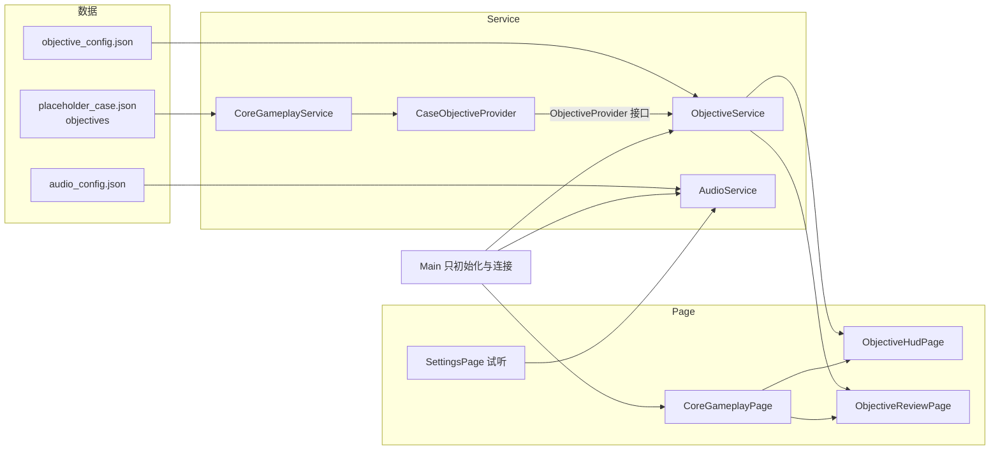

# 目标导航与声音播放实现清单

[TOC]

> 依据：`game/代码开发需求/目标导航系统/`、`game/代码开发需求/声音播放系统/` 的策划案、说明与配置表，以及 `代码生成规范.md` 的 `page → service → main` 约定。
> 范围：两个系统按策划案做到可运行、可回归、可在 Godot 桌面版直接试玩。正式案件内容与正式声音素材尚未交付，目前使用占位案件目标与测试音频，不能宣称这部分已完成。

## 一、结论

| 系统 | 状态 | 主程序接入 | 自动回归 |
| --- | --- | --- | --- |
| 目标导航：当前目标 HUD | 已完成 | `CoreGameplayPage` 右侧，`Main` 创建服务并连接 | 逻辑 248 项、页面 223 项 |
| 目标导航：调查回顾、依据查看、前往核对 | 已完成 | 同上，经 `CaseObjectiveProvider` 读取案件 | 同上 |
| 声音播放：音景、操作音、结果音与配音、暂停与失焦、设置试听 | 已完成 | `Main` 创建、连接设置／窗口焦点／暂停／读档 | 服务 207 项、接入 79 项 |
| 正式案件目标、正式地点与事件 | 未交付 | 占位案件 `objectives` 驱动 | 无 |
| 正式声音素材（UI、结果音、配音、场景音景） | 未交付 | 正式配置 0 个音景；开发运行叠加试听配置 | 无 |

两个系统都不依赖对方，也不依赖具体案件；案件模块和玩法模块只通过下面的两个接口接入。

## 二、架构

- 页面只持有自己的节点和输入处理；服务保存状态与规则；`Main` 不含业务逻辑。
- 目标导航不直接读核心玩法：案件目标、依据文本与“前往核对”都经提供方接口取得，换案件只需换提供方。
- 声音服务不推进剧情也不发起保存：页面和玩法只提交请求，是否播放、如何衔接、何时恢复由服务统一决定。

## 三、目标导航系统

### 3.1 已实现

- [x] 配置导入：`tools/import_objective_config.py` 只读导入配置表，输出 `data/objective/objective_config.json`（HUD、回顾、功能文字）与测试夹具（TEST00-TEST10 测试组、EX01-EX26 测试操作）；`--check` 可核对与配置表一致。
- [x] 数据校验：`ObjectiveData` 校验并规范化主目标、事项、依据，缺主目标、事项重复等接入错误经 `integration_error` 报出。
- [x] 显示模型：`ObjectiveHudModel` 负责展开／折叠、最多可见条数、更新提示 2000 ms、提亮 300 ms、滚动位置保持。
- [x] 服务：`ObjectiveService` 按刷新来源区分 `initial`／`result`／`restore`，只有 `result` 才产生更新提示、标记与提亮；暂停或隐藏时冻结计时；减弱动态下不提亮。
- [x] 回顾状态机：`closed → preparing → open`，异步准备与异步读取，失败原因显示在入口附近，重试时清除，离开场景后清除。
- [x] 页面：`ObjectiveHudPage`（当前目标）、`ObjectiveReviewPage`（调查回顾）、`ObjectiveReadingView`（单份阅读）、`ScrollList`（滚动列表）。
- [x] 键盘：Enter 打开回顾；Tab 焦点不会越过回顾；Esc 返回调查而不打开暂停菜单；回顾内按 I 不另开办案手册；返回后焦点回到“调查回顾”入口。
- [x] 案件接入：`CaseObjectiveProvider` 把占位案件 `objectives` 映射成目标；回顾期间借用核心的检视占用（此时不能新建存档）；“前往核对”按事项进入对应入口或问题选材。
- [x] 其他模块接入点：对白、选材、手册、暂停期间隐藏并冻结；读档按已有进度重建且不补播更新提示；读取另一档失败时目标内容、开合与标记保持不变（EX15）。
- [x] 两套参考布局：紧凑 1280×800 与基准 1920×1080。

### 3.2 布局取值

| 项目 | 紧凑 1280×800 | 基准 1920×1080 |
| --- | --- | --- |
| HUD 面板（x、y、宽） | 932、100、300 | 1494、136、368 |
| HUD 面板最大高度 | 320 | 340 |
| 折叠宽度 | 174 | 174 |
| 回顾画布 | 1600×900，缩放 0.8，原点 (0, 40) | 缩放 1.2 |
| 回顾三区（x、y、宽、高） | 主 [68, 245, 430, 400]；待核 [558, 286, 945, 200]；进展 [558, 568, 945, 246] | 同左 |

### 3.3 提供方接口

案件模块实现 `systems/objective/objective_provider.gd` 的子类，再由 `Main` 调用 `objective_service.bind_provider(provider)`，页面与导航服务无需改动。

| 接口 | 作用 |
| --- | --- |
| `signal objective_changed` | 目标记录或案件结果变化，导航据此重新读取 |
| `objective_snapshot()` | 当前目标快照：主目标、待核事项、已有进展、依据与可前往状态 |
| `prepare_review()` | 回顾开始前的准备，可同步返回 `true／false` 或异步完成 |
| `end_review()` | 回顾结束，归还借用的占用 |
| `read_basis(basis_id)` | 读取单个依据（原文或来源），可异步 |
| `recheck_entry(entry_id)` | 前往核对前复查入口是否仍可用 |
| `go_entry(entry_id)` | 进入对应调查入口或问题选材，返回 `{ok, reason}` |

### 3.4 占位案件数据

`game/data/core/placeholder_case.json` 新增 `objectives` 段：主目标 `GOAL_PLACEHOLDER` 下四项 `OBJ_INSPECT`、`OBJ_TALK`、`OBJ_Q1`、`OBJ_Q2`，以及 `OWNS_A1`、`Q2_DONE` 两个条件。`core_catalog.gd` 在配置加载时校验该段。正式案件交付后直接替换这一段或换提供方。

合入 main 后，默认运行改读故事工作簿（`故事配置表.xlsx`）。工作簿目前没有 `objectives` 段，加载器也不读取该段，所以默认运行不显示目标面板（提供方返回空快照，HUD 按“无目标”隐藏，不报错）。占位案件现作为测试模板保留，目标页面测试经 `Main.story_workbook_path` 指向它走完整接入。工作簿需要目标时，由案件内容一侧补 `objectives` 段并扩展加载器，`core_catalog.gd` 会照常校验。

## 四、声音播放系统

### 4.1 已实现

- [x] 配置导入：`tools/import_audio_config.py` 只读导入配置表，输出 `data/audio/audio_config.json`（总控、资源、事件、音景）；`--check` 可核对一致。
- [x] 总线：`default_bus_layout.tres` 建立 `BGM`、`Ambient`、`Effect` 三条总线；设置页的总音量、BGM、环境、效果音量与静音真正作用于它们。
- [x] 输出倍率：最终输出 = 事件增益 × 总音量 × 分项音量 × 播放系数；静音为 0；0 对应约 -80 dB。
- [x] 音景：标题、场景、结局三类，准确阶段行优先于同场景通用行；同一首曲子切换音景时不重启；缺失资源记制作错误且不替换曲目。
- [x] 交叉淡化：BGM 等功率交叉淡化 800 ms，环境淡化 300 ms；只有淡化进行时服务才逐帧推进。
- [x] 暂停与失焦：打开暂停菜单时 BGM 降为 50% 继续，环境与结果、配音停在原位置；窗口失焦全部冻结，回焦后仍等待一次有效输入。若此时在暂停菜单中，该输入先恢复菜单／标题 BGM 与界面声音，继续原调查后才恢复环境与世界声音；不在菜单中则同次全部恢复。
- [x] 一次性声音：点击、确认、文件反馈、结果音、节点音、配音按槽位占轨；同一实例只处理一次；旧调查会话的请求被拒绝；新调查会话清空去重表。
- [x] 请求结果状态：`played`、`duplicate`、`stale`、`frozen`、`held`、`empty`、`unbound`、`missing`、`silent`，空引用与未绑定都不算制作错误。
- [x] 设置页试听：按“静音、总音量、效果音、资源就绪”顺序判定能否试听，原因用功能文字键显示，离开设置页停止试听。
- [x] 性能：播放器池最多保留 8 个空闲播放器；实例去重表上限 256；音景只做字典查找；循环流只缓存当前所需。

### 4.2 槽位

| 槽位 | 总线 | 暂停菜单中 | 说明 |
| --- | --- | --- | --- |
| `bgm` | BGM | 倍率 50%，继续播放 | 音景 BGM |
| `ambient` | Ambient | 冻结 | 音景环境 |
| `ui` | Effect | 不受影响，只受失焦影响 | 点击、确认、文件反馈 |
| `result` | Effect | 冻结，不建立新声音 | 结果音、节点音 |
| `voice` | Effect | 冻结，不建立新声音 | 配音 |
| `preview` | Effect | 不受影响 | 设置页试听 |

### 4.3 主程序接入点

| 时机 | 调用 |
| --- | --- |
| 创建与设置 | `Main._setup_audio()` 载入配置；`settings_service.changed` 连到 `apply_settings`；设置就绪后才播放音景 |
| 标题页 | `set_soundscape("title")`，并 `stop_node_media()` |
| 进入或继续调查 | `set_soundscape("scene", 当前场景)`；读档成功时 `rebuild` 从头重建 |
| 新游戏、继续、读档 | `begin_session()` 使旧请求失效 |
| 暂停与继续 | `set_menu_open(true／false)`；暂停由用户操作触发时先 `notify_valid_input()` |
| 窗口焦点 | `focus_exited／focus_entered` 连到 `notify_window_focus` |
| 按钮操作 | `attach_ui_hook(tree)` 对被接受的按钮操作播放点击音；`ui_sound=none` 元数据可关闭 |
| 文件操作 | 保存或读取实际返回后发一次反馈音；自动存档静默 |
| 核心表现 | `presentation_requested` 的 `sound` 经 `play_result` 发一次 |
| 其他模块 | 声明 `signal media_requested(request)`，`Main._wire_media(source)` 连到 `request_media` 即可 |

### 4.4 试听音频与曲目授权

仅在开发运行与试玩台使用，全部放在 `game/tests/fixtures/` 下，`export_presets.cfg` 已排除 `tests/*`，不会进入导出包。清单与来源页见 `game/tests/fixtures/music/manifest.json`，由 `tools/fetch_test_music.py` 生成（`--dry-run` 只核对授权）。

| 曲目 | 传统 | 截取 |
| --- | --- | --- |
| J. S. Bach：d 小调托卡塔与赋格 BWV 565（管风琴） | 德国古典 | 80 秒 |
| W. A. Mozart：小夜曲 K.525 第一乐章 | 德奥古典 | 75 秒 |
| Richard Wagner：女武神的骑行（爱迪生唱片） | 德国古典 | 75 秒 |
| Beethoven：第九交响曲《欢乐颂》主题 | 德国古典 | 38 秒 |
| Beethoven／H. van Dyke：Joyful, Joyful We Adore Thee（美国空军乐队） | 基督教颂歌 | 80 秒 |
| A. Alexandrov：苏联国歌（1968 年器乐版） | 苏联 | 70 秒 |
| A. Khachaturian：亚美尼亚苏维埃共和国国歌（器乐） | 苏联古典 | 75 秒 |
| 格里高利圣咏：震怒之日 Dies irae | 基督教圣咏 | 90 秒 |
| W. A. Mozart：安魂曲 K.626 震怒之日（1956 年录音） | 德奥古典／基督教 | 80 秒 |
| Martin Luther：Ein feste Burg ist unser Gott（美国陆军乐队） | 基督教颂歌 | 75 秒 |

- 十首共约 7.5 MB（OGG Vorbis），每首只取开头一段，加淡入淡出并统一响度。
- 授权均按 Wikimedia Commons 页面标注（公有领域），**正式发布前必须再核对一次**；尤其是现代录音版本（如 1956 年安魂曲录音）的录音权利以页面为准。
- 开发运行另叠加 `tests/fixtures/audio/audio_demo_config.json`（12 条试听音景）。
- 三个操作音（点击、确认、文件反馈）由 `tools/generate_audio_test_assets.py` 自制，开发运行时经 `AudioService.bind_resource` 临时绑定；正式配置中这三个资源仍为“未绑定”，不会发声，设置页试听在正式配置下显示禁用原因。

## 五、在 Godot 桌面版试玩

用 Godot 4.7.2 打开 `game/project.godot`，首次会导入新增的音频与场景资源。

1. **完整游戏**：按 F5。标题页播放 Bach 托卡塔；点“新游戏”后切到 Mozart K.525 并叠加震怒之日圣咏作环境音。默认运行读取故事工作簿，它还没有目标段落，所以调查页右侧不显示“当前目标”（见 3.4）。
2. **当前目标**：用第 5 项的目标试玩台查看，右侧是正式的目标面板与回顾页：切换 TEST 组观察“已更新”提示，点标题栏折叠或展开，点“调查回顾”打开回顾页，可“查看原文／查看来源”和“前往核对”。
3. **暂停与设置**：按 Esc 或点“菜单”，BGM 降为一半、环境冻结；在设置页拖动音量滑条可即时听到变化，点“试听效果音”听反馈音；点击按钮有点击音，保存与读取后有文件反馈音。
4. **声音试玩台**：在编辑器打开 `res://tests/bench/audio_bench.tscn` 后按 F6。左侧点音景切换曲目，右侧显示当前曲目的作者、授权、来源与实时状态；可模拟失焦、回焦、暂停菜单、静音、四项音量、重复请求与过期会话。
5. **目标试玩台**：打开 `res://tests/bench/objective_bench.tscn` 后按 F6，可切换 TEST00-TEST10 测试组并逐步演练 EX01-EX26。
6. 不想听音乐时：把 `Main` 节点的 `audio_demo` 取消勾选。

## 六、自动回归

在仓库根目录执行（二选一）：

- `powershell -File tools/project.ps1 -Action test -Godot <Godot 4.7.2 控制台版路径>`（也可先设置环境变量 `GODOT_BIN`）。
- `..\.venv\Scripts\python.exe .local\tools\run_godot_tests.py`：本机辅助脚本，位于被 Git 忽略的 `.local/`，可加 `--only 名称`、`--verbose`、`--no-import`。

| 测试脚本 | 项数 | 内容 |
| --- | --- | --- |
| `objective_navigation_test.gd` | 248 | 目标数据、模型、服务、回顾状态机、提供方、TEST00-TEST10 与 EX01-EX26 |
| `objective_navigation_page_test.gd` | 223 | 真实鼠标键盘事件、HUD 与回顾布局（1280×800 与 1920×1080）、经真实 `Main` 的案件接入（占位案件模板，见 3.4） |
| `audio_service_test.gd` | 207 | 配置校验、音景匹配与衔接、音量公式、暂停失焦、一次性声音、试听、性能与池上限 |
| `audio_integration_test.gd` | 79 | 经真实 `Main` 的音景、设置联动、暂停、读档、文件反馈与退出 |
| 既有 5 个脚本 | 不变 | 工作台、核心玩法 133、核心输入 130、导航检查、重复确认 |

当前 9 个脚本全部通过。测试存档与设置写入独立目录，不改玩家数据。

## 七、已知限制与未验证项

- [ ] 人工听感与长时间试听：自动化只验证状态、倍率与资源，不能代替耳朵；请在桌面版实际听一遍，尤其是交叉淡化与失焦恢复。
- [ ] 导出包：本机未安装导出模板，未做导出与独立运行核对；`export_presets.cfg` 已把 `data/audio`、`data/objective` 配置加入 `include_filter`。
- [ ] 正式素材：UI 操作音、结果音、配音与场景音景尚未交付；正式配置中它们为“未绑定”，不会发声也不算制作错误。
- [ ] 正式案件：目标由占位案件驱动；调查棋盘、地点切换、事件触发与正式案件目标待后续系统接入，届时替换提供方即可。
- [ ] 默认故事工作簿没有目标段落：F5 的完整游戏不显示目标面板，加载器读取 `objectives` 后才会显示（见 3.4）。
- [ ] 曲目授权：见 4.4，发布前需再核对。
- [ ] 仓库与虚拟环境位于 OneDrive 目录：`.venv` 与 `game/.godot` 体积大且频繁变化，建议在 OneDrive 中排除同步。
- 重新生成试听素材才需要 `numpy` 与 `soundfile`（已写入 `requirements.txt`）；游戏本身与测试不依赖 Python。
